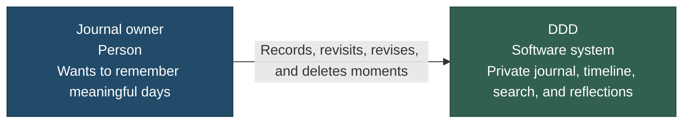
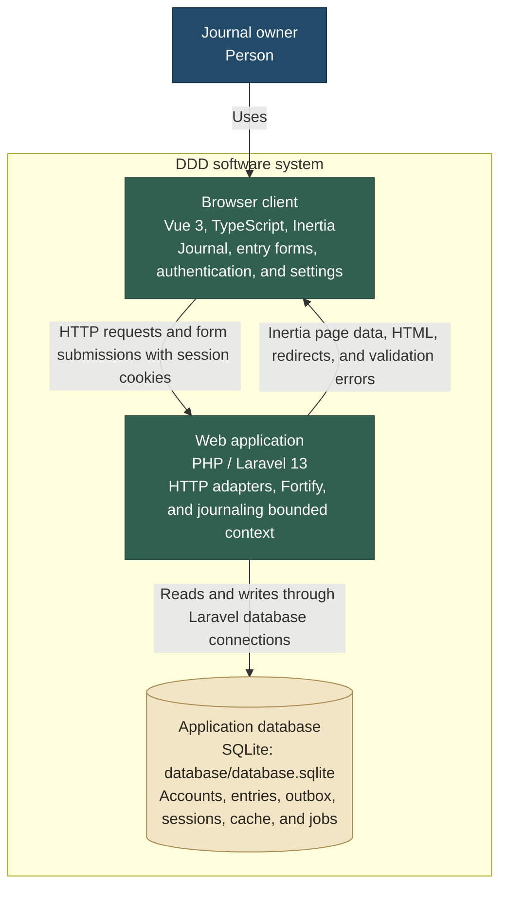
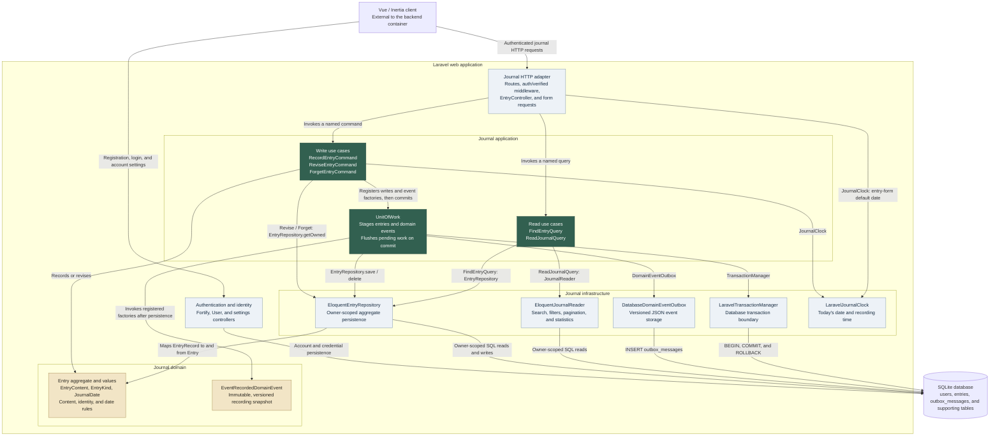
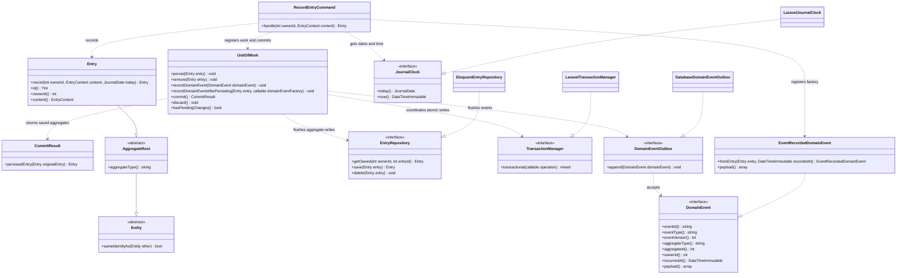
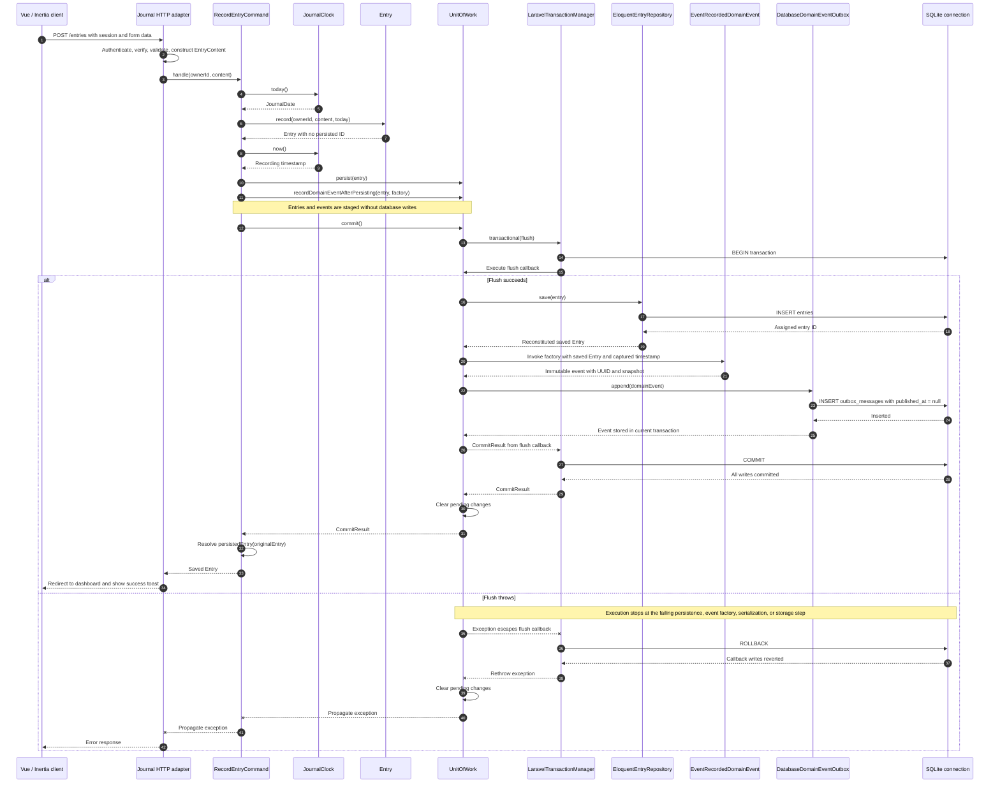

# DDD architecture diagrams

These diagrams describe the current implementation and the default local configuration. They use [C4's context, container, component, and code views](https://c4model.com/diagrams), expressed in Mermaid flowcharts and a class diagram. A sequence diagram explains the transactional recording flow.

The code blocks are the editable diagram sources. Open this file in a Mermaid-enabled Markdown preview to render them, or paste an individual block into a Mermaid editor.

| View                                                                 | Question it answers                                   |
| -------------------------------------------------------------------- | ----------------------------------------------------- |
| [C1: System context](#c1-system-context)                             | Who uses DDD, and for what?                           |
| [C2: Containers](#c2-containers)                                     | What runs where, and where is data stored?            |
| [C3: Laravel components](#c3-laravel-components)                     | Which backend components collaborate?                 |
| [C4: Recording code and contracts](#c4-recording-code-and-contracts) | Which classes and interfaces implement recording?     |
| [Recording sequence](#recording-sequence)                            | How do an entry and its domain event commit together? |

## C1: System context

DDD is a personal journal. Each authenticated, verified account records its own meaningful events, accomplishments, and achievements and revisits them through a private timeline.

Account registration, verification, password recovery, two-factor authentication, and passkeys are capabilities of the same system. The default mail driver writes verification and recovery messages to a local log.

## C2: Containers

Here, a container means a runtime application or data store. The browser client and Laravel backend are parts of the same product; the database is an embedded SQLite file in the default configuration.

The entry and outbox tables share one database connection so their writes can be atomic. Outbox messages remain pending with `published_at = null`.

`composer dev` additionally starts Vite for development assets and a Laravel queue worker. The queue worker processes Laravel jobs; an outbox publishing worker has not been implemented. Local mail is written to `storage/logs/laravel.log`. These supporting development details are separate from the core container view above.

Sources: [frontend bootstrap](../resources/js/app.ts), [HTTP routes](../routes/web.php), [default configuration](../.env.example), and [outbox schema](../database/migrations/2026_11_09_000001_create_outbox_messages_table.php).

## C3: Laravel components

This view zooms into the Laravel application. **Arrows show runtime calls**, with interface names on the relevant relationships. The application classes import those interfaces; the infrastructure implementations are supplied by `JournalServiceProvider`.

- Authentication middleware supplies the verified account identity to the journal HTTP adapter. The journal domain represents its owner by integer identity.
- `FindEntryQuery` loads an owned aggregate through `EntryRepository` and maps it to `EntryView`. `ReadJournalQuery` uses `JournalReader` to obtain read models directly.
- All write commands stage their changes with `UnitOfWork` and call `commit()`. Only `RecordEntryCommand` registers `EventRecordedDomainEvent`. Revisions and deletions do not emit this event.
- The journal domain and application layers have no Laravel, Eloquent, or Inertia dependencies. See the [dependency direction diagram](domain-driven-design.md#responsibilities-and-dependencies) for source-level dependencies.

Sources: [HTTP adapter](../app/Http/Controllers/EntryController.php), [container bindings](../app/Providers/JournalServiceProvider.php), and [bounded-context guide](domain-driven-design.md).

## C4: Recording code and contracts

This code view focuses on the active recording command. Dotted dependency arrows point from a caller to an abstraction; implementation arrows point from an adapter to the interface it implements.

`Entry::id()` is nullable before persistence. `EventRecordedDomainEvent::fromEntry()` requires a saved identity. `UnitOfWork::commit()` returns a `CommitResult`, which resolves the command's original entry to its saved instance. The Unit of Work clears its queue on success or failure.

The [domain abstraction diagram](domain-abstractions.md) expands the shared `ValueObject`, `Entity`, and `AggregateRoot` hierarchy and shows which journal types implement each role.

Sources: [RecordEntryCommand](../app/Journal/Application/Commands/RecordEntryCommand.php), [Entry](../app/Journal/Domain/Entries/Entry.php), [EventRecordedDomainEvent](../app/Journal/Domain/Events/EventRecordedDomainEvent.php), and [service-provider bindings](../app/Providers/JournalServiceProvider.php).

## Recording sequence

The command stages work before the Unit of Work starts a transaction on the shared database connection. The success branch expands the flush callback; the failure branch represents an exception at any point in that callback, including after the outbox insert.

`LaravelTransactionManager` invokes the flush callback inside Laravel's database transaction. An exception escaping the callback causes rollback. `UnitOfWork` clears pending changes in both cases. HTTP and domain validation errors can be rejected before work is staged or a transaction begins.

See [the outbox contract](outbox.md) for payload versioning, deduplication boundaries, account-deletion behavior, and pending-message storage.

## Keeping the diagrams current

Update these views when adding a runtime process, a new bounded context, a command/query dependency, a domain-event type, or an outbox delivery path. Keep source-level dependency direction distinct from runtime calls, and keep entry occurrence dates distinct from domain-event recording timestamps.

Notation references: [C4 model](https://c4model.com/diagrams), [Mermaid flowcharts](https://mermaid.js.org/syntax/flowchart.html), [Mermaid class diagrams](https://mermaid.js.org/syntax/classDiagram.html), and [Mermaid sequence diagrams](https://mermaid.js.org/syntax/sequenceDiagram.html).
