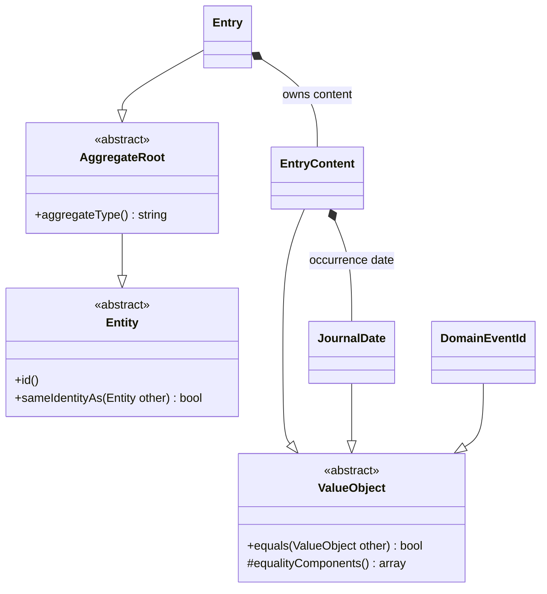

# Domain abstractions

The reusable domain foundation lives under `app/Shared/Domain`. It depends only on PHP. Journal domain classes depend on this foundation; the shared classes have no knowledge of journaling, Laravel, persistence, transactions, or the outbox.



## ValueObject

[`ValueObject`](../app/Shared/Domain/ValueObject.php) is an abstract readonly class. Concrete value objects are readonly and provide explicit, normalized scalar components through `equalityComponents()`. The final `equals()` method compares the exact concrete type and those components without inspecting private fields or serializing objects.

The journal implementations are:

- `EntryContent`: compares title, kind, occurrence date, story, and reflection after their existing normalization. Separate `JournalDate` instances representing the same day compare equally as content components.
- `JournalDate`: compares the canonical `YYYY-MM-DD` date.
- `DomainEventId`: compares the UUID value.

```php
$firstDate = JournalDate::fromString('2026-11-08');
$secondDate = JournalDate::fromString('2026-11-08');

$firstDate->equals($secondDate); // true, despite being separate objects
```

Readonly properties cannot be reassigned. Concrete value objects should contain immutable members, as the journal values do. `EntryKind` continues to use native enum case equality. Read-only query DTOs remain application read models rather than becoming domain value objects merely because they are readonly.

## Entity

[`Entity`](../app/Shared/Domain/Entity.php) defines an `id()` contract and a final `sameIdentityAs()` comparison. Concrete entities own their identity representation and validation. The shared contract supports integer, string, or value-object identities, and `null` for a new entity whose identity has not been assigned.

Identity comparison follows these rules:

- Concrete entity types must match.
- An object has the same identity as itself, including before persistence.
- Two different objects with null identities are distinct entities.
- Assigned scalar identities use strict comparison, so integer `7` and string `'7'` are different.
- Value-object identities use `equals()`.
- Other state, such as an entry's title or content, does not decide identity.

`Entry` retains its existing nullable integer identity, immutable owner, and positive-identity validation. A persisted entry and another instance with the same entry ID share identity even if their content differs. Owner checks remain enforced by owner-scoped repository operations.

## AggregateRoot

[`AggregateRoot`](../app/Shared/Domain/AggregateRoot.php) extends `Entity` and requires a stable `aggregateType()`. It represents the aggregate's persistence and consistency boundary.

`Entry` extends this abstraction and declares `Entry::AGGREGATE_TYPE = 'journal_entry'`. `EventRecordedDomainEvent` uses that same constant for its aggregate metadata, keeping the root and its recorded events consistent.

The journal repository and Unit of Work continue to accept `Entry` aggregate roots explicitly. Their APIs do not expose persistence of an aggregate's internal value objects or arbitrary nested entities. Event staging and flushing remain explicit responsibilities of the [Unit of Work](unit-of-work.md).

Semantic entity identity and Unit of Work instance registration serve different purposes. Two loaded instances can have the same entity identity, while the Unit of Work rejects registering conflicting instances of that identity and resolves commit results for the exact instance registered by the caller.

## Verification

```sh
vendor/bin/phpunit tests/Unit/Shared
vendor/bin/phpunit tests/Unit/Journal
composer ci:check
```

Tests cover value equality, concrete-type separation, readonly state, assigned and unassigned identities, strict scalar comparison, value-object identifiers, aggregate-root inheritance, normalized journal values, and unchanged outbox metadata. Architecture tests enforce dependency direction for the shared domain, journal domain, and application layers.
