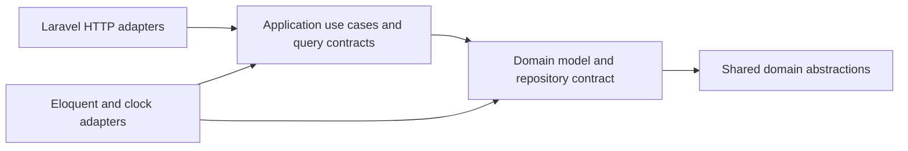

# Journaling bounded context

DDD's core domain is remembering meaningful events, accomplishments, and achievements. The shared language in code is **entry**, **kind**, **occurrence date**, **story**, **reflection**, and **owner**.

An `Entry` is the aggregate root. Each moment has its own identity and owner; an entire user's history does not need to be loaded to change one moment. The timeline and its statistics are read projections.

The [shared domain abstractions](domain-abstractions.md) define `ValueObject`, `Entity`, and `AggregateRoot` under `app/Shared/Domain`. `Entry` extends `AggregateRoot`; `EntryContent`, `JournalDate`, and `DomainEventId` extend the readonly `ValueObject` base.

See the [C4 and Mermaid diagrams](architecture.md) for the system context, runtime containers, backend components, recording contracts, and outbox sequence.

## Responsibilities and dependencies

```text
app/Journal/
  Domain/
    Entries/
      Entry.php             Aggregate; recording and revision rules
      EntryContent.php      Immutable, validated content
      JournalDate.php       Immutable calendar date without a timezone shift
      EntryKind.php         Event, Accomplishment, Achievement
      EntryRepository.php   Aggregate persistence contract
      InvalidEntry.php      Domain rule violations with field errors
      EntryNotFound.php     Missing or inaccessible entry
    Events/
      DomainEvent.php              Explicit event metadata and payload contract
      DomainEventId.php            Framework-independent event identity
      EventRecordedDomainEvent.php Immutable fact that an entry was recorded
    JournalClock.php        Source of today's date and recording timestamps
  Application/
    Commands/
      RecordEntryCommand.php Record a moment for its owner
      ReviseEntryCommand.php Load an owned aggregate, revise it, save it
      ForgetEntryCommand.php Load an owned aggregate and remove it
    Queries/
      FindEntryQuery.php     Read an owned entry for editing
      ReadJournalQuery.php   Read the timeline and statistics
      JournalReader.php     Timeline query contract
      JournalFilters.php    Query inputs
      EntryView.php         Entry read model
      JournalPage.php       Page of entries and journal statistics
      JournalStatistics.php Journal totals
    Outbox/
      DomainEventOutbox.php  Domain event storage contract
    Transactions/
      TransactionManager.php Atomic application operation contract
    UnitOfWork/
      UnitOfWork.php        Tracks and flushes pending entries and events
      CommitResult.php      Resolves registered entries to saved aggregates
  Infrastructure/
    Persistence/Eloquent/
      EntryRecord.php             Database record, casts, and factory
      EloquentEntryRepository.php Maps records to domain aggregates and back
      EloquentJournalReader.php   SQL filtering, ordering, pagination, statistics
    Time/
      LaravelJournalClock.php     Application timezone and Laravel's test clock
    Outbox/
      DatabaseDomainEventOutbox.php JSON event persistence
    Transactions/
      LaravelTransactionManager.php Database transaction boundary
```



The shared domain uses PHP and its standard extensions. The journal `Domain` may depend on the shared domain. `Application` depends on domain abstractions and its own contracts and read models. These inner layers do not import Laravel, Eloquent, Inertia, the authentication model, or infrastructure implementations. Architecture tests enforce these namespace dependencies, including that shared code does not depend on journaling.

## Explicit command and query conventions

Write use cases have a `Command` suffix; read use cases have a `Query` suffix. Each class lives in a file with the same name and exposes a typed `handle()` method. Controllers invoke these use cases directly through dependencies named for the operation, such as `$recordEntryCommand` and `$findEntryQuery`.

Injected dependencies describe their role, such as `$entriesRepository` and `$journalReader`. Multiline signatures and named arguments at HTTP call sites make the owner, entry identity, and content explicit. Loading, revising, and persisting an entry are separate steps.

Read models (`EntryView`, `JournalPage`, `JournalStatistics`) and the `JournalReader` port keep their descriptive role names. `ReadJournalQuery` is the application operation; `JournalReader` is the interface used to obtain its data.

## Business rules

- `EntryContent` requires a nonblank title and story, normalizes surrounding whitespace, and turns an empty reflection into `null`. Title, story, and reflection limits live here. `EntryKind` restricts the kinds a moment can have.
- `JournalDate` rejects impossible or malformed dates. It represents a day, not a timestamp, so a saved occurrence date is preserved across timezones.
- `Entry::record()` and `Entry::revise()` reject future occurrence dates using the date supplied by the clock. A rejected revision leaves the aggregate unchanged. These rules also apply when use cases run outside HTTP.
- An entry's identity and owner cannot change during revision. Repository lookups require the authenticated owner's identity. Both persistence adapters scope access to that owner; an entry owned by someone else appears missing. The write repository also checks ownership when updating or deleting.

The repository reconstitutes persisted entries without reapplying the recording-time future-date check. Historical data remains readable if the configured timezone or clock changes.

## Laravel integration

`app/Providers/JournalServiceProvider.php` binds `EntryRepository`, `JournalReader`, `JournalClock`, `TransactionManager`, and `DomainEventOutbox` to the infrastructure implementations and creates transient `UnitOfWork` instances. Laravel constructs the application use cases through dependency injection.

All write commands register changes with the [Unit of Work](unit-of-work.md), which defers writes until commit. `RecordEntryCommand` also registers a factory for `EventRecordedDomainEvent`. The Unit of Work saves the entry and appends that event to the outbox in one transaction, then clears pending changes. The event captures the saved identity and immutable content; failed writes roll back together. See [the outbox contract](outbox.md) for event metadata, payload versioning, retention, and pending-message behavior.

`app/Http/Controllers/EntryController.php` handles the HTTP adapter: it reads authenticated identity, invokes an explicit command or query, builds pagination links, and returns Inertia responses or redirects. Form requests validate HTTP input and convert it into typed domain values. Their field checks mirror domain limits for immediate form feedback; the aggregate and value objects independently enforce the business rules.

`bootstrap/app.php` translates `InvalidEntry` into form validation errors and `EntryNotFound` into HTTP 404. Domain code has no knowledge of HTTP status codes or Laravel exceptions.

Fortify and `app/Models/User.php` provide identity and authentication. The journal references an owner's integer identity rather than depending on the authentication model. The infrastructure record has the database relationship; the existing foreign key continues to remove journal entries when an account is deleted.

The `entries` table and frontend routes and props retain their existing format. The outbox migration adds `outbox_messages`; existing entries are preserved and are not backfilled with recorded events.

## Verification

```sh
vendor/bin/phpunit tests/Unit/Journal
php artisan test --filter=JournalTest
composer ci:check
```

The unit tests extend PHPUnit's base test case and exercise the domain and application with an in-memory repository and fixed clock. They do not boot Laravel or access a database. Feature tests exercise HTTP behavior, real Eloquent persistence, ownership, filters, pagination, exception translation, and account deletion.
